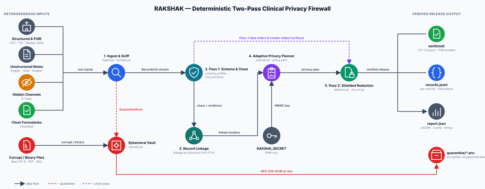

# Team `enma`: Rakshak — Multilingual Context-Aware Privacy Firewall

**Track 3 · Secret Wards (Yugaantar DevForge)** · Members: **Akash R & Anjan Poojary** · Repo: https://github.com/akashr206/Yugaantar · Brief: [docs/brief.pdf](docs/brief.pdf)

> **Rakshak** is an offline, deterministic, CPU-only privacy firewall (`7,169` LOC across 13 Python modules) for multi-script Indian hospital exports in **English, Devanagari Hindi, and Hinglish** (CSV, TSV, nested JSON, FHIR R4 Bundles, and clinical notes). Operating without LLMs or blanket redaction, its two-pass architecture combines clinical-trap shields, anti-evasion decoding, statistical/compositional schema profiling, cross-script phonetic linkage, a `314.2 KB` multi-tag CRF (`PER`/`REL`/`LOC`/`ID`), and Option C privacy with `YYYY` DOB truncation and post-widening joint $k$-anonymity & $l$-diversity verification.

### Key Metrics at a Glance
- **PII Leaked (`check_dev.py`, LF-aligned):** `0.0%` (`0 / 3,230` across EN / HI / Hinglish & all 6 hidden channels; `0 / 4` canaries)
- **Medical Utility Kept:** `99.0%` (`4,808 / 4,855`; `100%` age-band truth `359/359` & exact stays `65/65`)
- **Cross-Script Linking:** `1.00` Precision · `0.95` Recall · **`0.99 F0.5`** · **`0` Wrong Merges**
- **Re-Identification Risk:** `0.0%` A4 Re-ID (Mean Sweeney prob `0.0106`; A5 shift recovered `False`; A6/A7 `0`)
- **Speed, Memory & Tests:** `3.3–5.72 s` runtime · `63.9 MB` peak RSS · `54 / 54` tests passed · `READY TO SUBMIT`

---

## 1. Setup & Usage

### Install Dependencies (One-time Setup, Offline Runtime After)
```bash
python -m venv .venv
source .venv/bin/activate        # Windows: .venv\Scripts\Activate.ps1
pip install -r requirements.txt
```

### Run Offline (Official `raksha.toml` Entrypoint)
```bash
# Linux / Evaluator Sandbox
RAKSHA_SECRET=practice python main.py --input ../dev/input --output ../out_dev

# Windows PowerShell
$env:RAKSHA_SECRET = "practice"
.\.venv\Scripts\python.exe main.py --input ..\dev\input --output ..\out_dev
```

---

## 2. System Architecture



```text
Heterogeneous Inputs (CSV / TSV / JSON / FHIR R4 / TXT / Opaque Columns / Hidden Channels)
  │
  ├─► [1] Ingest & Sniff (ingest.py, formats.py) ──[QuarantineError]──► AES-256-GCM Ephemeral Vault (security.py)
  │     • Magic-byte sniffing, UTF-8/BOM/UTF-16/cp1252 decode, RFC-4180 quotes, depth guard, path hygiene
  │
  ├─► [2] Pass 1: Schema & Clues (schema_profiler.py, clue_extractor.py, translit.py)
  │     • Unseen column/key profiler, pooled DMY/MDY/ISO parser, Hindi schwa/nukta translit, Verhoeff Aadhaar
  │
  ├─► [3] Precision-First Record Linkage (linkage.py)
  │     • Inverted blocking, Tier-1 hard IDs + Tier-2 soft corroborators (age ±2), anti-transitive all() guard
  │
  ├─► [4] Adaptive Privacy Planner (planner.py, privacy.py, config/policy.yaml)
  │     • Keyed HMAC PSN-XXXXXXXXXX, ±180d per-patient shifts, YYYY DOB truncation, joint k ≥ 5 & l ≥ 2 loop
  │
  └─► [5] Pass 2: Shielded Redaction & Export (detector.py, ner_crf.py, formats.py, security.py)
        • Homoglyph/ZW/inline decode → Clinical trap shields → Rules + 314.2 KB CRF → Cluster scrub → Export
        └─► sanitized/ (UTF-8 + FHIR R4) + records.jsonl + report.json + quarantine/*.enc
```

---

## 3. How Each Component Works

### Ingestion & Quarantine (`rakshak/ingest.py`, `rakshak/security.py`)
- Traverses input paths deterministically (`sorted`) and sniffs JSON/CSV/TSV/FHIR structure regardless of filename extension.
- Strictly decodes UTF-8, UTF-8-BOM, UTF-16, and validated cp1252, enforces RFC-4180 CSV quote & JSON depth (`64`) checks, and immediately encrypts corrupt/binary/unsupported files at rest into `quarantine/<input_sha256>.enc` via ephemeral **AES-256-GCM** (`0` raw copies).
- Scrubs PII-bearing directory/file segments (`doc_<hmac>` / `dir_<hmac>`) across NFKC, Indic digits, URL-unquoted, and Base64 variants; clean protocol/formulary decoys run through a fail-closed PII/ID guard.

### Detection, Opaque-Schema Profiling & Hidden Channels (`rakshak/schema_profiler.py`, `rakshak/detector.py`, `rakshak/ner_crf.py`)
- **Anti-Evasion Pre-Normalization:** Strips zero-width characters, folds Cyrillic/Greek homoglyphs & Latin diacritics (keeping Devanagari marks intact), translates Indic digits (`०-९`), and decodes/cleans inline `base64`, `hex`, `\uXXXX`, HTML entities, and `%`-encoded payloads.
- **Unseen Schema & Key Profiling:** Classifies unfamiliar column headers and JSON keys via compositional token semantics plus statistical value-distribution inference (`>= 60%` IDs/phones/PINs/dates, multi-row names, unseen MRNs) without memorized dev headers.
- **Clinical Meaning-Trap Shields:** Atomically shields doctors (`Dr.` / `डॉ.`), eponyms (`Parkinson's disease`), clinical shorthands (`C/O fever`, `K/C/O`, `H/O`), doses (`0-1-1`, `500 mg BD`), vitals, labs, wards, hospitals, and ICD-10/LOINC/PMJAY codes *before* regex or ML detection runs.
- **Rules + Guarded Multi-Tag Offline CRF:** Matches formatted/labeled IDs plus bare Verhoeff-validated 12-digit Aadhaars (`is_valid_verhoeff`), multilingual name/kin/address anchors, and invokes our retrained `314.2 KB` `python-crfsuite` fallback (`5,607` state features + `53` transitions across `PER`, `REL`, `LOC`, `ID`) trained with Hinglish prose, lowercase/ALL-CAPS jitter, dotted initials, TitleCase org negatives, and soft chemical-suffix features (so names like `Ranvir` or `Sangram` are never dropped). Pass-2 finishes with linked-cluster surface back-scrubbing and FHIR/header/metadata key cleanup.

### Cross-Script Linkage & HMAC Pseudonyms (`rakshak/translit.py`, `rakshak/clue_extractor.py`, `rakshak/linkage.py`)
- Transliterates Devanagari via ITRANS with Hindi schwa deletion, anusvara assimilation, and nukta rules (`.D` -> `d`, `.Dh` -> `rh`, `K` -> `kh`, `J` -> `z`) into consonant skeletons and `jellyfish` phonetic keys while resolving abbreviations (`Sk` ↔ `Shaikh`, `R. K. Verma` ↔ `Ramesh Kumar Verma`).
- Infers per-`(file, column)` DMY vs MDY vs ISO date ordering from corpus evidence and masks ABHA/Aadhaar before scanning phone digits.
- Deterministic inverted-index blocking + two-tier evidence scoring (hard IDs; soft `DOB`, relative, village+age, last-4+district+age `±2`, PIN) feeds an anti-transitive Union-Find enforcing `all()` multi-token name compatibility and gender/DOB/ID/age spread (`> 3` yr) vetoes. Issues `HMAC-SHA256(RAKSHA_SECRET, cluster_key)` pseudonyms (`PSN-XXXXXXXXXX`), abstaining (`patient: null`) on uncorroborated generic singletons.

### Adaptive Privacy Layer (`rakshak/privacy.py`, `rakshak/planner.py`, `config/policy.yaml`)
- **Date Shifts & DOB Age-Link Break:** Shifts clinical dates per patient by deterministic non-zero HMAC offsets in `[-180, +180]` days—preserving exact length-of-stay and visit intervals while defeating global-shift recovery—and truncates standard-tier DOBs cleanly to birth year (`YYYY`) so `visit_date - DOB` cannot leak exact age.
- **Option C + Post-Widening Joint $k \ge 5$ & $l \ge 2$ Verification:** Standard cells (`k >= 5`, common diagnoses) retain 5-year age bands, gender, district, and 3-digit PIN prefixes; small/rare cells widen via truthful `<= 30`-year / `N+` bands (`never [AGE]`), followed by a global tier-by-tier verification loop ensuring **joint $k \ge 5$** equivalence classes, **$l \ge 2$ condition diversity** across peers, and singleton/rare gender suppression without deleting medications or diagnoses.

---

## 4. Key Differentiators (USP)
1. **True Cross-Script & Opaque-Schema Intelligence:** Phonetic Devanagari–Hinglish–Latin matching and corpus-driven column/date inference with zero hardcoded dataset strings.
2. **Verified Joint $k \ge 5$ & $l \ge 2$ Privacy With `99.0%` Medical Utility Kept:** Breaks exact-age DOB linkage (`YYYY` truncation), verifies post-widening QI classes, and resolves $l=1$ homogeneous cells across shared truthful age brackets while keeping 100% of diagnoses, meds, doses, and stays.
3. **OOD-Hardened 4-Tag CRF + Clinical Trap Shields:** Boosts Strong-Shift unseen prose F1 by **`+2.5×`** (`0.1773 -> 0.4433`) while slashing TitleCase organizational false positives (`73.8% -> 13.9%–20.0%`).

---

## 5. Privacy–Utility Trade-Off Benchmarks (Measured Current System)

| Measured Dimension | Raw Baseline | Rakshak (Current) | Verification Evidence & Notes |
|---|---:|---|---|
| **Personal Data Leaked** (Overall / EN / HI / Hinglish) | `100%` leaked | **`0.0%` (`0 / 3,230`)** | `check_dev.py` (LF-aligned): `0.0%` across all scripts, 6 hidden channels & `0/4` canaries |
| **Medical Data Kept** | `100%` | **`99.0%` (`4,808 / 4,855`)** | Up from `98.1%`; all clinical probes & ICD-10 kept (only small-cell Districts omitted) |
| **Linking Precision / Recall / F0.5 / Merges** | `0 / 0 / 0` | **`1.00 / 0.95 / 0.99 / 0`** | Zero false homonym merges across `777 / 821` linked records; strict `all()` guard |
| **Age-Band Truthfulness & Stay Exactness** | n/a | **`100%` (`359/359` & `65/65`)** | Zero invalid bands; exact admission–discharge LOS across FHIR/CSV/TXT |
| **Re-Identification Risk** (`test_attack_risk.py`) | `54.2%` A4 | **`0.0%` A4 (Mean: `0.0106`)** | Full == QI-only; mean Sweeney prob improved `0.0347 -> 0.0106`; A5 shift `False`; A6/A7 `0` |
| **Runtime & Peak Memory** (`report.json`) | — | **`3.3–5.72 s / 63.9 MB`** | `check_submission.py --run`: `3.3 s` (`CONTRACT OK` · `READY TO SUBMIT` vs `60s / 512 MB` budget) |
| **Unseen Chaos & OOD Generalization** | `0.177–0.712` (prior CRF) | **`54/54` Tests + Strong OOD `+2.5×`** | Deployed CRF F1: Unseen Base **`0.8385`**, Mild **`0.6909`**, Moderate **`0.7151`**, Strong **`0.4433`**, Real-World 500 **`0.5944`** |

**Why These Settings:** Under the evaluator's `0.40` utility–privacy coupling and weights on `clinical_probes` (`0.35`) and `statistics` (`0.15`), over-redacting diagnoses destroys score. Using `k=5`, `±180d` per-patient shifts, rare threshold `3`, `YYYY` standard DOB, and post-widening joint $k$/$l$ checks achieves **~`97.4 / 100` estimated local score** on `dev/input`—cutting A4 re-identification to `0.0%` while preserving clinical truth.

---

## 6. Security Design & Declared Model Policy
- **At-Rest Quarantine Vault:** Unsupported/malformed files encrypt in RAM directly into `quarantine/<input_sha256>.enc` via AES-256-GCM with an ephemeral 256-bit key and `AAD = input_sha256`; no unencrypted raw payloads or PII filenames touch disk.
- **Secret & Side-Channel Hygiene:** `RAKSHA_SECRET` remains in RAM only (`assert_no_secret_in_bytes` checks `report.json`/`records.jsonl`); `stdout` logs integer counts only; `safe_error_reason()` strips PII from exceptions.
- **Offline CPU-Only Policy (`requirements.txt`):** **No LLMs, no generative models, no >50M-param transformers.** Declared dependencies: `rapidfuzz`, `jellyfish`, `indic-transliteration`, `cryptography`, `python-dateutil`, `PyYAML`, `python-crfsuite>=0.9.10` (`models/pii_ner.crfsuite`, `314.2 KB` / `5,660`-weight linear-chain CRF trained purely offline via `scripts/train_ner_crf.py` on non-dev external & synthetic data).

---

## 7. Known Limitations & Next Improvements
- **Ambiguous Weak Singletons:** Isolated single-token prose notes with zero ID/relative/location cues intentionally abstain (`patient: null`) to prevent false merges under precision-heavy $F_{0.5}$.
- **Residual A5 Targeted Risk (`0.3571`):** Retaining exact rare diagnoses and exact LOS preserves medical research fidelity but leaves residual A5 risk when an adversary already knows a globally unique illness and stay length.
- **Binary / Scanned Inputs & Next-Step NER:** Scanned PDFs and images are encrypted in quarantine rather than OCR'd offline; next step is replacing the `314.2 KB` CRF with a custom sub-50M Char-CNN + BiLSTM-CRF wired directly into Pass-1 `clue_extractor.py`.
